<p align="center">
  
</p>

<h1 align="center">Reiseplaner</h1>

<p align="center">
  Reisen lokal auf dem eigenen Rechner planen, dokumentieren und auswerten:<br>
  Flüge und andere Verbindungen, Unterkünfte, Aktivitäten, Aufgaben und Packliste, Ausgaben in jeder Währung,<br>
  Kosten teilen mit Mitreisenden, Tabellen und Diagramme – mit Abgleich über Nextcloud bzw. WebDAV. Für macOS, Windows und Linux.
</p>

<p align="center">
  <a href="LICENSE"></a>
  <a href="#entstanden-mit-ki"></a>
</p>

<p align="center">
  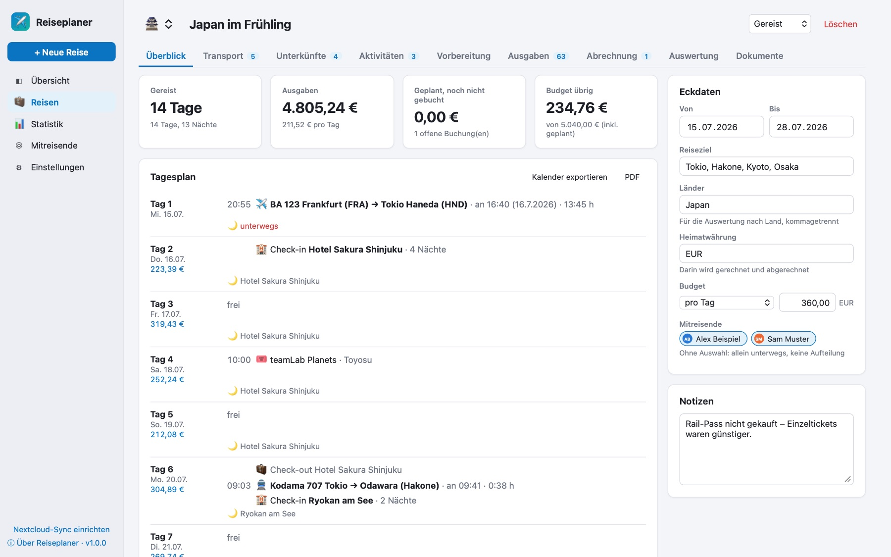
</p>

<p align="center"><sub>Beispieldaten mit erfundenen Namen (Demo-Modus, siehe <a href="#entwicklung">Entwicklung</a>)</sub></p>

---

## Inhalt

- [Worum geht es?](#worum-geht-es)
- [Funktionen](#funktionen)
- [Screenshots](#screenshots)
- [Erste Schritte](#erste-schritte)
- [So wird gerechnet](#so-wird-gerechnet)
- [Gemeinsam nutzen mit Nextcloud](#gemeinsam-nutzen-mit-nextcloud)
- [Wo liegen die Daten?](#wo-liegen-die-daten)
- [Datenschutz](#datenschutz)
- [Installation](#installation)
- [Entwicklung](#entwicklung)
- [Projektstruktur](#projektstruktur)
- [Bauen und Veröffentlichen](#bauen-und-veröffentlichen)
- [Sicherheit](#sicherheit)
- [Bekannte Einschränkungen](#bekannte-einschränkungen)
- [Entstanden mit KI](#entstanden-mit-ki)
- [Lizenz, Abhängigkeiten und Quellen](#lizenz-abhängigkeiten-und-quellen)

## Worum geht es?

Der Reiseplaner gehört zur Familie von Hausplaner, Tourenplaner, Autoplaner und Partyplaner: eine schlanke
Desktop-App, die alles zu einer Reise an einem Ort sammelt. Vorher wird geplant (Verbindungen, Unterkünfte,
Programm, Aufgaben, Packliste), unterwegs werden die Ausgaben erfasst, und am Ende zeigt die Auswertung, wohin das
Geld gegangen ist – pro Tag, Kategorie, Land, Zahlungsart und Person.

Die App läuft lokal. Ein Konto oder ein eigener Server ist nicht nötig. Wer möchte, gleicht die Daten über
Nextcloud zwischen mehreren Rechnern oder mit Mitreisenden ab.

## Funktionen

### Reisen
- Zeitraum, Reiseziel, Länder, Symbol, Status (*Idee → In Planung → Gebucht → Gereist*, *Abgesagt*)
- Heimatwährung je Reise und ein **Budget** für die ganze Reise oder pro Tag
- Mitreisende auswählen – oder allein reisen, dann gibt es keine Aufteilung
- **Überblick** mit Countdown, Ausgaben, geplanten Kosten, Budget-Rest und einem **Tagesplan**: für jeden Tag
  An- und Abreise, Check-in und Check-out, Aktivitäten, die Übernachtung und die Ausgaben des Tages
- Hinweise auf Nächte ohne Unterkunft, fehlende Wechselkurse, offene Aufgaben und Ausgaben ohne Zahler

### Planen
- **Transport:** Flug, Zug, Fernbus, Fähre, eigenes Auto, Mietwagen, Taxi/Transfer, Nahverkehr, Fahrrad –
  mit Abfahrt und Ankunft (Ortszeit), Anbieter, Flug- bzw. Zugnummer, Sitzplatz, Terminal/Gleis, Buchungsnummer,
  Link, Strecke in km und Dauer. Die Dauer wird aus den Zeiten berechnet oder bei Zeitzonen von Hand eingetragen.
  Eine neue Verbindung startet dort, wo die letzte angekommen ist.
- **Unterkünfte:** Hotel, Ferienwohnung, Hostel, Camping, privat, Schiff/Nachtzug – mit Check-in/-out samt Uhrzeit,
  Adresse, Telefon, Buchungsnummer, Preis pro Nacht. **Verpflegung**: nur Übernachtung, Frühstück, Halbpension,
  Vollpension, All-Inclusive oder einzelne Mahlzeiten. **Kurtaxe** bzw. City Tax pro Person und Nacht, pro
  Person und Tag, pro Nacht, pro Tag oder als Gesamtbetrag; sie wird als eigene Ausgabe übernommen (oder als „im Preis enthalten“ markiert). Lücken im Zeitraum werden
  angezeigt und lassen sich mit einem Klick füllen.
- **Aktivitäten:** Ausflüge, Führungen, Reservierungen oder einfach Ideen, nach Tagen sortiert.
- Jede Buchung hat einen **Status**: *Idee* und *Reserviert* zählen als geplante Kosten, *Gebucht* wird
  **automatisch als Ausgabe übernommen** (Unterkünfte verteilt auf die Nächte, Mietwagen auf die Miettage),
  *Storniert* zählt nirgends.
- **Vorbereitung:** Aufgaben vor der Reise (mit Termin und Zuständigkeit) und eine **Packliste** mit Abschnitten.
  Beides entsteht aus Vorlagen, die sich in den Einstellungen anpassen lassen.
- **Kalender-Export** (.ics) aller Verbindungen, Unterkünfte und Aktivitäten, **PDF** mit Tagesplan, Buchungen,
  Ausgaben und Abrechnung.

### Ausgaben
- Schnell erfassen: Datum, Betrag, Währung, Kategorie, Zahlungsmittel, optional wofür – Enter, fertig.
- 12 Kategorien (Flüge, Transport, Auto/Sprit/Maut, Unterkunft, Essen & Trinken, Lebensmittel, Aktivitäten,
  Shopping, Visum/Gebühren/Kurtaxe, Internet & Telefon, Gesundheit, Sonstiges)
- **Beliebige Währungen** mit Wechselkursen, die von Hand gepflegt werden (in beide Richtungen eingebbar,
  z. B. „1 EUR = 161,5 JPY“); einzelne Ausgaben können einen eigenen Kurs haben, etwa laut Kreditkartenabrechnung.
- Land, **Zahlungsmittel** (frei benennbar in den Einstellungen, z. B. Bar, Kreditkarte Visa, Revolut,
  Reisekasse – auch bei Buchungen), Notiz
- Über mehrere Tage **verteilen** (Rail-Pass, Mietwagen) und **aus dem Tagesdurchschnitt ausnehmen**
  (Anreise, vorab bezahlte Versicherung). Gebuchte Flüge sind standardmäßig ausgenommen.
- Liste nach Tagen mit Tagessummen, Suche und Filter nach Kategorie, Person und Zahlungsmittel, CSV-Export

### Mitreisende und Abrechnung
- Wer hat bezahlt, auf wen wird verteilt (alle oder eine Auswahl)
- Salden, bereits geflossene Zahlungen und **möglichst wenige Überweisungen**; mit ✓ als bezahlt eintragen
- Abrechnung als Text kopieren oder als CSV speichern

### Auswerten
- Je Reise: Gesamt, Ø pro Tag, **Ø pro Person und Tag**, Budget
- **Säulendiagramm pro Tag**, aufgeschlüsselt nach Kategorie oder Zahlungsmittel, für die Gruppe oder pro Person
- Tabellen und Balken nach Kategorie und **Zahlungsmittel**; nach Land und Währung; pro Person
- Tabelle **Tag für Tag** mit Gesamt, Schnitt pro Person und dem Anteil jeder mitreisenden Person (CSV-Export)
- Umschalter **„Ganze Gruppe / Mein Anteil“**
- **Statistik über alle Reisen**: Reisen, Reisetage, Nächte, Länder, Ausgaben pro Reise als Diagramm, nach
  Kategorie, Land, Zahlungsmittel und Jahr, Ø pro Tag und pro Person und Tag, Verkehrsmittel mit Anzahl, km und Stunden, Budget-Abweichung je Reise, CSV-Export

### Routenkarte
- Jede Reise als Karte: alle Verbindungen als **Luftlinie** in Reihenfolge, mit Farbe und Symbol je Verkehrsmittel
  (Flüge gestrichelt), nummerierte Stationen und Unterkünfte als 🏠
- **Ganze Route** oder **Vor Ort** (nur die Orte in den Reiseländern, ohne An- und Abreise); Klick auf eine Strecke
  zoomt auf diese Verbindung
- Entfernungen je Strecke und Verkehrsmittel (Luftlinie)
- Orte werden ohne Online-Dienst erkannt: Flughafen-Codes wie „Frankfurt (FRA)“ und eine mitgelieferte Liste mit rund
  34.000 Städten (auch deutsche Namen wie „Lissabon“ oder „Mailand“); bei mehreren gleichnamigen Orten gewinnen die
  Länder der Reise. Unterkünfte über die Adresse, sonst den Namen.
- Kleinere Orte und Hotels **per Klick auf die Karte setzen**; das gilt dann für alle Reisen mit demselben Ortsnamen.

### Weltkarte
- Alle Länder, die du bereist hast, farbig auf einer Weltkarte; geplante Reisen und Wunschziele in eigenen Farben
- Zoomen mit Mausrad, Trackpad oder +/−, verschieben durch Ziehen; Klick auf ein Land zoomt hinein und zeigt die
  Reisen dorthin
- **Pro Person oder als Gruppe**: alle zusammen, eine Person oder mehrere – bei mehreren wahlweise *zusammen gereist*
  (gemeinsame Reise), *jeder war dort* (auch getrennt) oder *mindestens einer*
- Länder früherer Reisen ohne eigene Reise in der App **pro Person abhaken** („schon dort gewesen“, mit Jahr) und
  Notizen je Land
- **Offene Länder**: alle noch nicht besuchten Staaten, filterbar nach Kontinent, mit ★ als Favorit auf die Wunschliste
- Kennzahlen: Länder (von 197 Staaten), **Welt gesehen in Prozent der Landfläche** (ohne Antarktis), Kontinente,
  geplante Länder, Favoriten, Fortschritt je Kontinent
- Läuft komplett offline: Die Ländergrenzen sind in der App enthalten, es werden keine Kartenkacheln geladen.

### Dokumente
- Tickets, Bordkarten, Buchungsbestätigungen und Belege je Reise ablegen (per Drag & Drop) und mit
  Nextcloud abgleichen

## Screenshots

| Transport | Unterkunft mit Verpflegung und Kurtaxe |
| --- | --- |
| 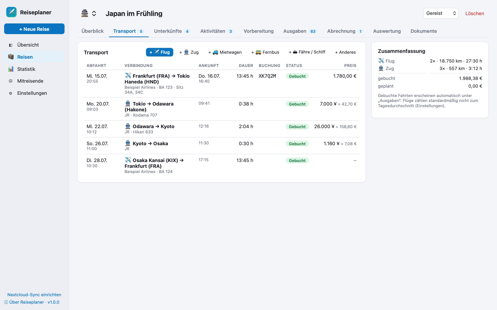 | 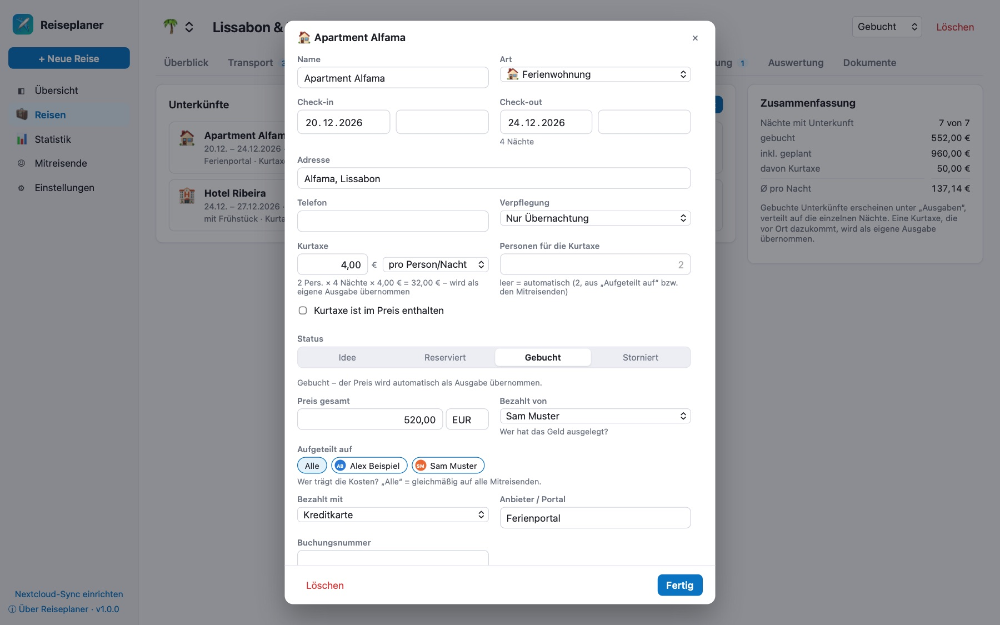 |
| **Ausgaben** | **Vorbereitung** |
| 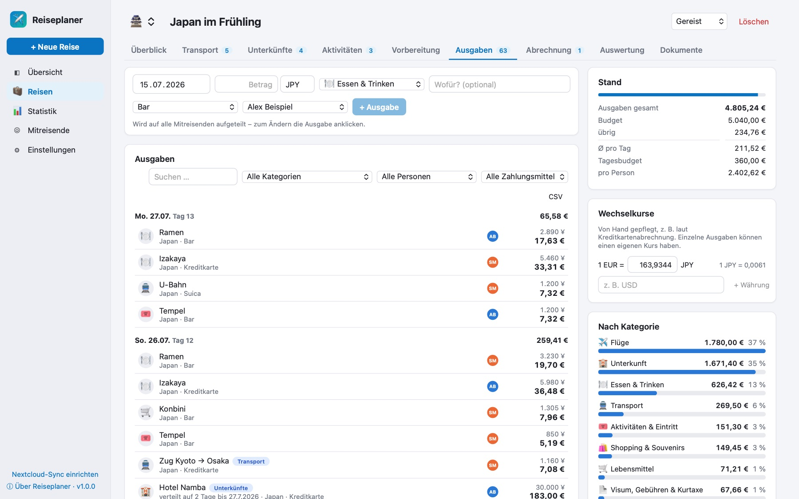 | 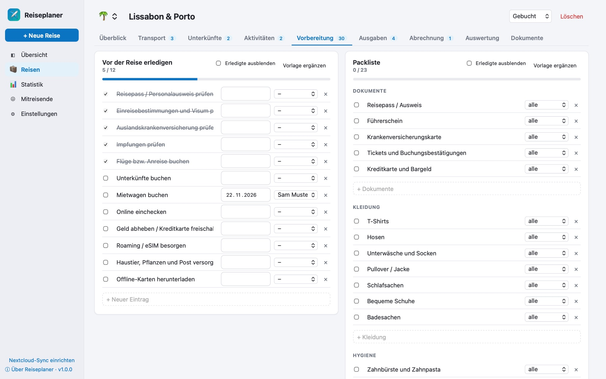 |
| **Auswertung** | **Zahlungsmittel und Tag für Tag** |
| 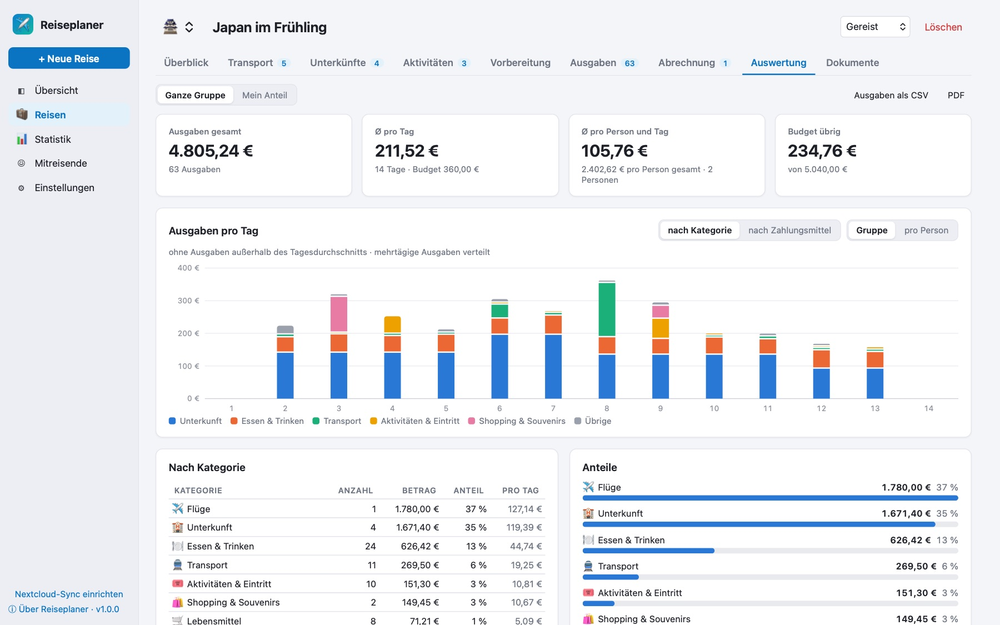 | 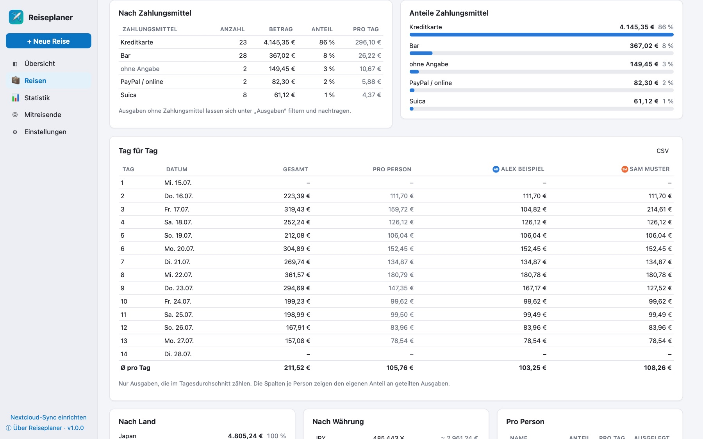 |
| **Routenkarte** | **Routenkarte „Vor Ort“** |
| 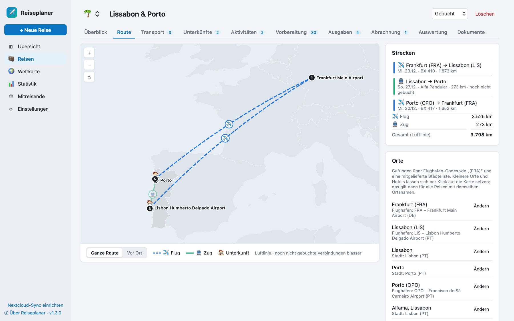 | 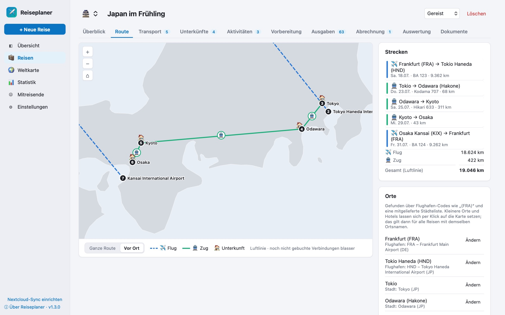 |
| **Weltkarte** | **Weltkarte für eine Gruppe** |
| 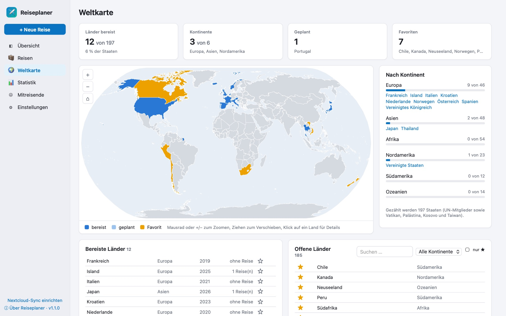 | 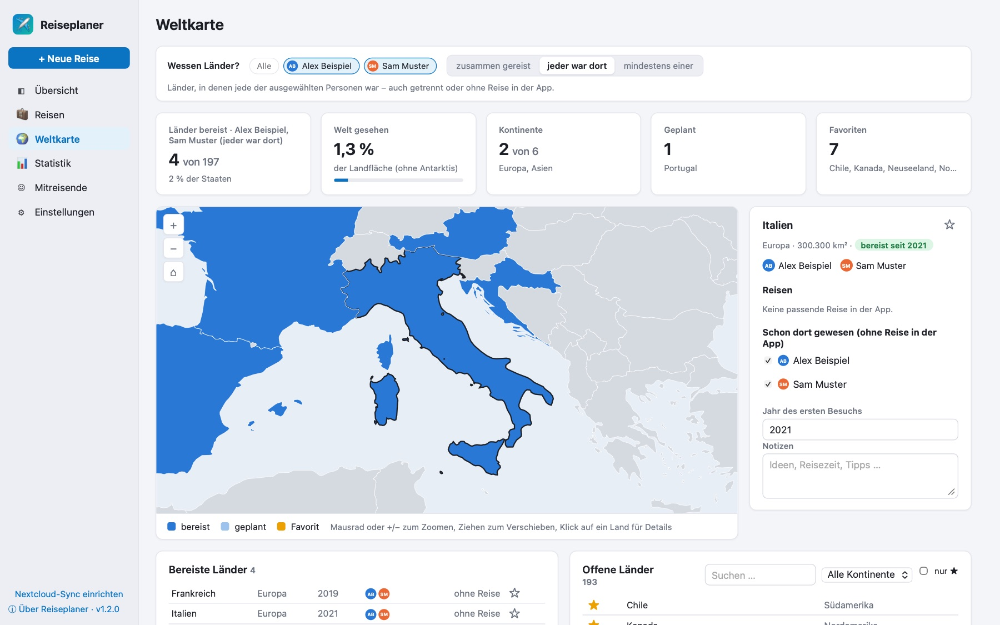 |
| **Abrechnung** | **Statistik über alle Reisen** |
| 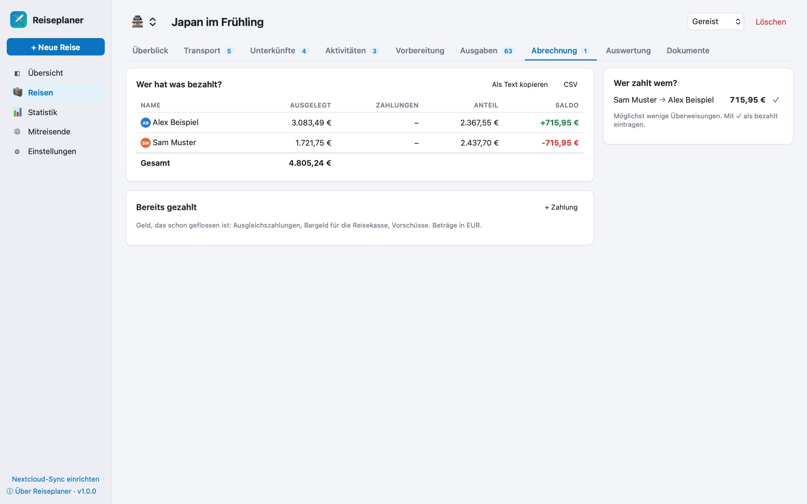 | 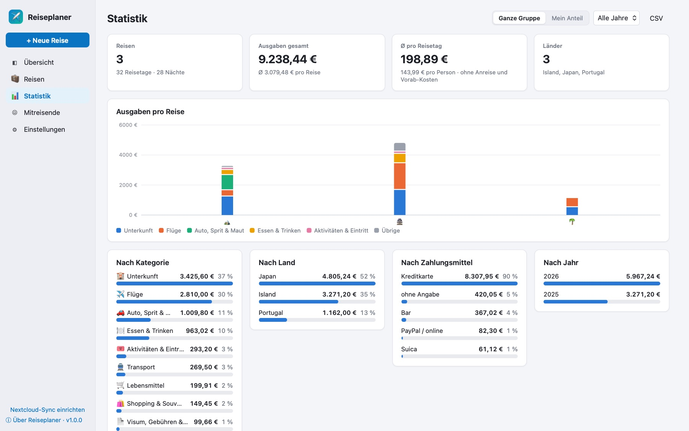 |

Personen, Buchungsnummern und Beträge in den Bildern sind erfunden.

## Erste Schritte

1. Optional unter **Mitreisende** dich selbst anlegen und „Das bin ich“ wählen – dann wirst du bei neuen Reisen
   automatisch eingetragen und als Zahler vorausgewählt.
2. **+ Neue Reise**, im Überblick Zeitraum, Reiseziel, Länder, Heimatwährung und ggf. Budget eintragen.
3. Unter **Transport**, **Unterkünfte** und **Aktivitäten** planen; was fest ist, auf *Gebucht* stellen.
4. Unterwegs unter **Ausgaben** erfassen; für Fremdwährungen den Kurs rechts eintragen.
5. Am Ende **Auswertung** und **Abrechnung** ansehen; unter **Statistik** alle Reisen vergleichen.

## So wird gerechnet

- **Umrechnung:** Jede Ausgabe wird mit ihrem eigenen Kurs oder dem Kurs der Reise in die Heimatwährung umgerechnet.
  Fehlt ein Kurs, zählt der Betrag noch nicht mit; die App weist darauf hin.
- **Tagesdurchschnitt** = Ausgaben im Reisezeitraum, die nicht ausgenommen sind, geteilt durch die Reisetage
  (An- und Abreisetag zählen mit). Ausgaben vor oder nach der Reise zählen zur Summe, nicht zum Durchschnitt.
- **Pro Person und Tag** = Tagesdurchschnitt geteilt durch die Zahl der Mitreisenden (allein bzw. beim eigenen
  Anteil: 1). Die Spalten je Person in „Tag für Tag“ zeigen dagegen den tatsächlichen Anteil an den geteilten Ausgaben.
- **Weltkarte**: Ein Land zählt für eine Person, wenn sie auf einer Reise dorthin eingetragen ist (Reisen ohne
  Mitreisende zählen für „Das bin ich“) oder es von Hand abgehakt ist. Als bereist gilt eine Reise mit Status
  „Gereist“ oder sobald sie begonnen hat; Ideen und Absagen zählen nicht. „Welt gesehen“ = Fläche der bereisten
  Länder geteilt durch die Landfläche der Erde ohne Antarktis (aus den Kartendaten berechnet).
- **Kurtaxe** = Betrag × Nächte bzw. Tage (× Personen, wenn pro Person); Tage = Nächte + 1. Ein Gesamtbetrag wird
  gleichmäßig auf die Tage von der Anreise bis zur Abreise verteilt. Die Personen ergeben sich aus „Aufgeteilt auf“
  bzw. den Mitreisenden oder werden eingetragen.
- **Verteilte Ausgaben** (Unterkunft, Mietwagen, „verteilen bis“) werden gleichmäßig auf die Tage aufgeteilt.
- **Geplant** sind Preise von Buchungen mit Status *Idee* oder *Reserviert*. Der Überblick zeigt Ausgaben plus
  Geplantes im Vergleich zum Budget.
- **Aufteilung:** Eine Ausgabe wird gleichmäßig auf die gewählten Mitreisenden verteilt (ohne Auswahl auf alle).
  Saldo = ausgelegt + gezahlte Ausgleichsbeträge − eigener Anteil, in ganzen Cent, sodass die Summe genau null ist.
  Daraus entstehen möglichst wenige Überweisungen (größter Schuldner an größten Gläubiger).

## Gemeinsam nutzen mit Nextcloud

Die App gleicht ihren Datenordner selbst per WebDAV ab; der Nextcloud-Client ist dafür nicht nötig.

1. In Nextcloud unter *Einstellungen → Sicherheit* ein **App-Passwort** anlegen.
2. In der App unter *Einstellungen → Daten & Sync* die Server-Adresse, den Benutzer, das App-Passwort und einen
   Ordner (Standard: `Reiseplaner`) eintragen, **Verbindung testen** und **Synchronisation aktivieren**.
3. Auf jedem weiteren Rechner dasselbe eintragen. Planen mehrere zusammen, den Ordner in Nextcloud mit
   Bearbeitungsrecht mit den Mitreisenden teilen und auf deren Rechnern den Pfad des geteilten Ordners angeben.

Abgeglichen wird beim Start, auf Knopfdruck und auf Wunsch alle 5, 15 oder 60 Minuten. Jeder Datensatz ist eine
eigene Datei – eine neue Ausgabe ändert nur eine Datei, deshalb gibt es kaum Konflikte. Wurde derselbe Datensatz
auf zwei Geräten geändert, gewinnt der neuere Stand; der andere liegt im Datenordner unter `conflicts/`.

## Wo liegen die Daten?

Standardmäßig im App-Datenordner; unter *Einstellungen → Daten & Sync* lässt sich ein anderer Ordner wählen.

| System | Ordner |
| --- | --- |
| macOS | `~/Library/Application Support/de.soeren3003.reiseplaner/data` |
| Windows | `%APPDATA%\de.soeren3003.reiseplaner\data` |
| Linux | `~/.local/share/de.soeren3003.reiseplaner/data` |

```
db/trips/<id>.json        Reisen (Zeitraum, Länder, Währung, Kurse, Budget, Mitreisende)
db/people/<id>.json       Mitreisende
db/transports/<id>.json   Flüge, Züge, Mietwagen …
db/stays/<id>.json        Unterkünfte
db/activities/<id>.json   Aktivitäten
db/checklist/<id>.json    Aufgaben und Packliste
db/expenses/<id>.json     Ausgaben
db/payments/<id>.json     Ausgleichszahlungen zwischen Mitreisenden
db/countries/<code>.json  Weltkarte: Favoriten, „schon dort gewesen“ je Person, Notizen je Land
db/places/<id>.json       Routenkarte: selbst gesetzte Orte (per Klick)
db/settings/settings.json Einstellungen und Vorlagen
files/<reise>/…           Dokumente je Reise
conflicts/                nur lokal: ältere Version bei Sync-Konflikten
```

Alle Dateien sind lesbares JSON. Für eine **Sicherung** genügt eine Kopie des Ordners; mit eingerichtetem Sync
liegt zusätzlich eine Kopie in der Nextcloud. Server, Benutzer und Ordner liegen getrennt in `config.json` im
Konfigurationsordner der App, das Passwort im System-Schlüsselbund.

## Datenschutz

- Die App speichert alles **nur lokal** und, wenn eingerichtet, in **deiner eigenen Nextcloud**. Es gibt keinen
  Server des Entwicklers, kein Konto, keine Statistik und keine Verbindungen ins Internet außer zu deinem
  WebDAV-Server. Auch Wechselkurse werden bewusst nicht online abgefragt.
- Buchungsnummern, Tickets und Bordkarten sind persönliche Daten. Teile den Sync-Ordner nur mit Mitreisenden.
- Mitreisende lassen sich löschen, solange sie bei keiner Reise eingetragen sind und in keiner Ausgabe vorkommen
  (sonst stimmen die Abrechnungen nicht mehr).

## Installation

Fertige Installer entstehen über GitHub Actions, sobald das Repository veröffentlicht und ein Versions-Tag
gesetzt ist (siehe [Bauen und Veröffentlichen](#bauen-und-veröffentlichen)). Bis dahin die App selbst bauen:

```bash
npm install
npm run tauri build
```

Die App ist **nicht signiert**. Unter macOS beim ersten Start Rechtsklick → *Öffnen*, unter Windows im
SmartScreen-Hinweis *Weitere Informationen → Trotzdem ausführen*.

## Entwicklung

**Voraussetzungen:** [Node.js](https://nodejs.org/) 20 oder neuer, [Rust](https://www.rust-lang.org/) (stable),
unter macOS die Xcode Command Line Tools, unter Linux die
[Tauri-Abhängigkeiten](https://tauri.app/start/prerequisites/).

```bash
npm install
npm run tauri dev      # Desktop-App mit Hot-Reload
npm run dev            # nur die Oberfläche im Browser (http://localhost:1420), Daten im localStorage
```

**Demo-Modus** (nur Browser-Vorschau): `http://localhost:1420/?demo` lädt drei erfundene Reisen (Japan zu zweit
in Yen, Portugal in Planung, Island allein mit Mietwagen). Mit `?trip=demo-japan&tab=analysis` öffnet sich direkt
eine Ansicht, mit `?page=statistics` die Statistik.

**Tests**

```bash
npm test                         # Umrechnung, Tage, Abrechnung, Auswertung, Buchungen, Tagesplan, Kalender, CSV, PDF
cd src-tauri && cargo test       # Datenablage, Dateinamen, WebDAV-URLs, XML-Parser
```

Sync-Integrationstest gegen einen lokalen WebDAV-Server:

```bash
pip install wsgidav cheroot
mkdir -p /tmp/dav/remote.php/dav/files/test
wsgidav --host=127.0.0.1 --port=8765 --root=/tmp/dav --auth=anonymous &
cd src-tauri && REISEPLANER_TEST_DAV=http://127.0.0.1:8765 cargo test --test sync_dav
```

**Lizenzhinweise** nach dem Hinzufügen oder Aktualisieren von Abhängigkeiten neu erzeugen:

```bash
npm run licenses       # schreibt THIRD_PARTY_LICENSES.md und src/generated/third-party.json
```

**Länderdaten** der Weltkarte neu erzeugen (nur nötig, wenn `world-atlas` aktualisiert oder die Länderliste im
Skript geändert wird):

```bash
npm run countries      # schreibt src/generated/world.json und src/generated/countries.json
```

**Ortsdaten** der Routenkarte neu erzeugen: [cities15000.zip](https://download.geonames.org/export/dump/cities15000.zip)
(GeoNames, entpacken) und [airports.csv](https://davidmegginson.github.io/ourairports-data/airports.csv) (OurAirports)
in einen Ordner laden, dann:

```bash
npm run places -- ~/Downloads/geodaten   # schreibt src/generated/places.json
```

## Projektstruktur

```
src/                      Oberfläche (React, TypeScript)
  App.tsx                 Seitenleiste und Navigation
  lib/types.ts            Datenmodell
  lib/calc.ts             Umrechnung, Tage, Abrechnung, Auswertung, Buchung → Ausgabe, Tagesplan
  lib/summary.ts          alles zu einer Reise zusammengesucht
  lib/export.ts           Kalenderdatei, CSV, Abrechnungstext, PDF
  lib/countries.ts        Länderliste, Namen erkennen, bereist/geplant/Favorit
  lib/places.ts           Ortssuche: Flughafen-Codes, Städte, selbst gesetzte Orte
  lib/route.ts            Route einer Reise, Luftlinien
  lib/csv.ts              CSV schreiben
  lib/store.tsx           Zustand, verzögertes Speichern, automatische Ausgaben, Sync-Auslöser
  lib/api.ts              Brücke zu Tauri (im Browser: localStorage)
  lib/demo.ts             erfundene Beispieldaten
  pages/                  Übersicht, Reisen, Statistik, Mitreisende, Einstellungen
  pages/trip/             Reiter einer Reise
  components/             Bedienelemente, Buchungsformulare, Weltkarte, Diagramme, Info-Fenster
  generated/              Lizenzliste, Länderliste, Ländergrenzen, Städte und Flughäfen (erzeugt)
src-tauri/                Desktop-Hülle (Rust)
  src/store.rs            JSON-Dateien je Datensatz, Dokumente
  src/sync.rs             Zwei-Wege-Abgleich mit Konfliktbehandlung
  src/webdav.rs           WebDAV-Client
  src/config.rs           lokale Einstellungen, Schlüsselbund
scripts/                  Versionsnummer setzen, Lizenzliste, Länder- und Ortsdaten erzeugen
```

## Bauen und Veröffentlichen

```bash
npm run tauri build                     # .app und .dmg unter src-tauri/target/release/bundle/
npm run tauri build -- --bundles app    # nur die .app
```

Der Workflow `.github/workflows/build.yml` baut bei einem Versions-Tag (`v1.0.0`) Installer für macOS, Windows
und Linux und legt ein GitHub-Release mit den Notizen aus dem [CHANGELOG.md](CHANGELOG.md) an. Die
Versionsnummer wird mit `npm run set-version -- 0.2.0` überall gleich gesetzt.

## Sicherheit

Siehe [SECURITY.md](SECURITY.md). Kurz: Die Oberfläche darf nur Dateidialoge öffnen und PDF-, CSV- und
Kalenderdateien schreiben; der Abgleich läuft nur über HTTPS (http:// nur zu einem Server auf dem eigenen Rechner); Datensatz-Kennungen und Dateinamen werden geprüft, Pfade vom Server, die den
Datenordner verlassen würden, werden ignoriert, Programme aus dem Dokumente-Ordner werden nicht direkt gestartet,
CSV-Exporte sind gegen Formel-Einschleusung geschützt, das App-Passwort liegt im Schlüsselbund, und die App lädt
keine Inhalte aus dem Internet.

## Bekannte Einschränkungen

- Wechselkurse werden nicht automatisch abgerufen, sondern von Hand gepflegt.
- Zeiten sind Ortszeiten ohne Zeitzone; bei Flügen über Zeitzonen die echte Dauer eintragen.
- Ausgaben werden gleichmäßig aufgeteilt; ungleiche Anteile (z. B. 70/30) gibt es noch nicht – dafür die
  Ausgabe teilen oder nur ausgewählten Personen zuordnen.
- Keine Straßenkarte und keine Flugdaten-Abfrage (bewusst ohne Online-Dienste); die Weltkarte zeigt Ländergrenzen,
  noch keine Bundesländer und Städte.
- Die Routenkarte zeigt Luftlinien, nicht den tatsächlichen Weg von Zug, Bus oder Auto. Orte unter 15.000 Einwohnern
  und Hotels müssen meist einmal per Klick gesetzt werden.
- Sehr kleine Staaten (z. B. Tuvalu) sind auf der Karte nur als Punkt oder gar nicht zu sehen, stehen aber in den Listen.
- Keine App fürs Handy; Ausgaben werden am Rechner erfasst.

## Entstanden mit KI

Der Reiseplaner ist in **Zusammenarbeit mit der KI [Claude](https://claude.ai) von Anthropic** entstanden, mit
[Claude Code](https://claude.com/claude-code).

- **Mensch (Soeren3003):** Idee und Anforderungen, Entscheidungen über Funktionen, Aufbau und Lizenz, Prüfen
  der Ergebnisse.
- **KI (Claude):** Architektur auf Basis von Partyplaner und Tourenplaner, Großteil von Quellcode, Tests und
  Dokumentation.

Commits, an denen die KI mitgearbeitet hat, sind mit `Co-Authored-By: Claude …` gekennzeichnet.

## Lizenz, Abhängigkeiten und Quellen

Der Reiseplaner ist freie Software unter der **[MIT-Lizenz](LICENSE)**. Jeder darf ihn nutzen, verändern und
weitergeben, auch kommerziell, solange der Copyright- und Lizenzhinweis erhalten bleibt.

### Direkte Abhängigkeiten

| Paket | Zweck | Lizenz |
| --- | --- | --- |
| [react](https://react.dev/), react-dom | Oberfläche | MIT |
| [jsPDF](https://github.com/parallax/jsPDF), jspdf-autotable | PDF-Export | MIT |
| [d3-geo](https://d3js.org/d3-geo), topojson-client | Weltkarte: Projektion und Ländergrenzen | ISC |
| [world-atlas](https://github.com/topojson/world-atlas) | Ländergrenzen aus [Natural Earth](https://www.naturalearthdata.com/) (1:50 Mio.) | ISC, Daten gemeinfrei |
| Daten: [GeoNames](https://www.geonames.org/) | Städte der Routenkarte (aufbereitet) | CC BY 4.0 – mit MIT vereinbar, Namensnennung erforderlich |
| Daten: [OurAirports](https://ourairports.com/) | Flughäfen der Routenkarte (aufbereitet) | gemeinfrei |
| [@tauri-apps/api](https://tauri.app/) | Brücke zur Desktop-Hülle | MIT OR Apache-2.0 |
| [@tauri-apps/plugin-dialog](https://tauri.app/plugin/dialog/) | Datei- und Ordnerdialoge | MIT OR Apache-2.0 |
| [tauri](https://tauri.app/), tauri-build | Desktop-Hülle | MIT OR Apache-2.0 |
| tauri-plugin-dialog, tauri-plugin-opener | Dialoge, Dokumente und Links öffnen | MIT OR Apache-2.0 |
| [serde](https://serde.rs/), serde_json | JSON lesen und schreiben | MIT OR Apache-2.0 |
| [reqwest](https://github.com/seanmonstar/reqwest) (mit rustls) | HTTPS für WebDAV | MIT OR Apache-2.0 |
| [quick-xml](https://github.com/tafia/quick-xml) | WebDAV-Antworten lesen | MIT |
| sha2, hex | Prüfsummen für den Sync | MIT OR Apache-2.0 |
| percent-encoding | WebDAV-Pfade | MIT OR Apache-2.0 |
| [chrono](https://github.com/chronotope/chrono) | Zeitstempel | MIT OR Apache-2.0 |
| [keyring](https://github.com/hwchen/keyring-rs) | App-Passwort im Schlüsselbund | MIT OR Apache-2.0 |

Nur zum Entwickeln (nicht in der App enthalten): TypeScript (Apache-2.0), Vite (MIT), Vitest (MIT),
happy-dom (MIT), @vitejs/plugin-react (MIT), @tauri-apps/cli (MIT OR Apache-2.0), @types/react (MIT).

Umrechnung, Abrechnung, Auswertung, CSV, Kalenderdatei und Diagramme sind selbst geschrieben – dafür gibt es keine
zusätzlichen Bibliotheken. Die Diagrammfarben folgen einer auf Farbfehlsichtigkeit geprüften Palette.

### Kartendaten der Welt- und Routenkarte

Welt- und Routenkarte brauchen keinen Online-Dienst. Alles, was sie zeigt, ist in der App enthalten oder wird von ihr selbst
berechnet:

| Was | Woher |
| --- | --- |
| Ländergrenzen (1:50 Mio.) | [Natural Earth](https://www.naturalearthdata.com/), Version 4.1.0, gemeinfrei – über das Paket [world-atlas](https://github.com/topojson/world-atlas) (ISC). Das Skript `scripts/countries.mjs` macht daraus einmalig `src/generated/world.json` mit ISO-3166-Codes. |
| Darstellung, Zoom, Einfärbung | eigener Code; die Kartenprojektion (Natural Earth 1) rechnet [d3-geo](https://d3js.org/d3-geo) (ISC) |
| Deutsche Ländernamen | aus dem Betriebssystem bzw. der Laufzeitumgebung (`Intl.DisplayNames`), ohne Internet |
| Kontinente, Liste der 197 Staaten | selbst festgelegt im Skript (UN-Mitglieder sowie Vatikan, Palästina, Kosovo und Taiwan) |
| Fläche je Land, „Welt gesehen“ | aus den Grenzen berechnet (Kugel mit Erdradius), Abweichung zu amtlichen Zahlen meist unter 2 % |
| Städte (Routenkarte) | [GeoNames](https://www.geonames.org/) „cities15000“, rund 34.000 Städte ab 15.000 Einwohnern, Lizenz [CC BY 4.0](https://creativecommons.org/licenses/by/4.0/); gekürzt auf Name, lateinische Alternativnamen, Koordinaten, Land und Einwohnerzahl (`scripts/places.mjs`) |
| Flughäfen (Routenkarte) | [OurAirports](https://ourairports.com/), gemeinfrei; nur Flughäfen mit IATA-Code und Linienverkehr bzw. mittlere und große (`scripts/places.mjs`) |
| Luftlinien, Entfernungen | Großkreis auf der Kugel, berechnet mit d3-geo |

Die Grenzen folgen den tatsächlichen Verhältnissen, wie Natural Earth sie abbildet. Sie sind keine politische Aussage
zu umstrittenen Gebieten; Flächen ohne eigenen ISO-Code (z. B. Somaliland, Nordzypern) werden dem Staat zugerechnet,
zu dem sie völkerrechtlich gehören.

### Alle mitgelieferten Komponenten

Mit allen indirekten Abhängigkeiten enthält die App rund 510 Komponenten (35 npm-Pakete, 476 Rust-Crates). Alle
stehen unter freien Lizenzen, die mit der MIT-Lizenz vereinbar sind:

| Lizenz | Bedeutung für dieses Projekt |
| --- | --- |
| MIT, BSD-3-Clause, ISC, Zlib, Apache-2.0, Unicode-3.0, CDLA-Permissive-2.0, BSL-1.0, 0BSD, Unlicense, CC0 | frei nutzbar; beim Weitergeben müssen Copyright und Lizenztext beiliegen |
| MPL-2.0 (5 Rust-Crates aus Tauri: `cssparser`, `cssparser-macros`, `dtoa-short`, `option-ext`, `selectors`) | schwaches Copyleft auf Dateiebene: unverändert genutzt, Quellcode öffentlich verlinkt |
| wahlweise MPL-2.0 oder Apache-2.0 (`dompurify`, über jsPDF) | es wird Apache-2.0 genutzt |
| wahlweise auch LGPL (`r-efi`) | es wird die freie Alternative (MIT bzw. Apache-2.0) genutzt |

Die vollständigen Lizenztexte stehen in **[THIRD_PARTY_LICENSES.md](THIRD_PARTY_LICENSES.md)** und in der App unter
*Über Reiseplaner → Lizenzen aller Komponenten anzeigen*. Die Dateien werden mit `npm run licenses` erzeugt.
